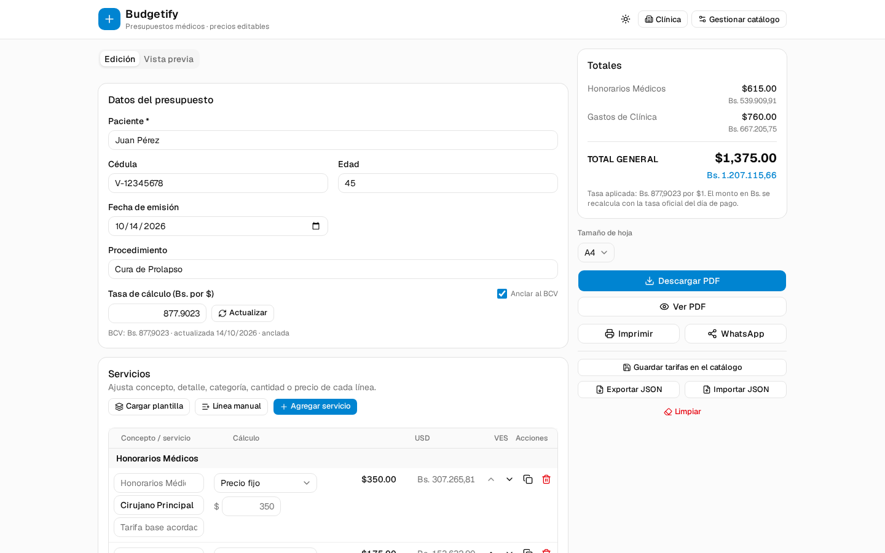
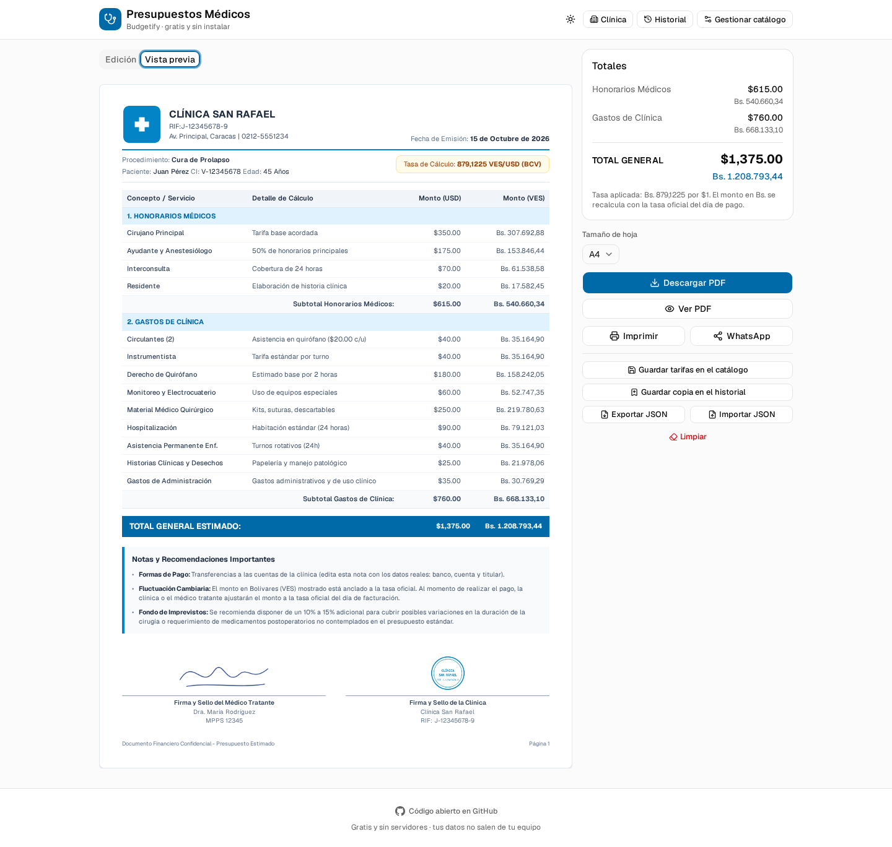
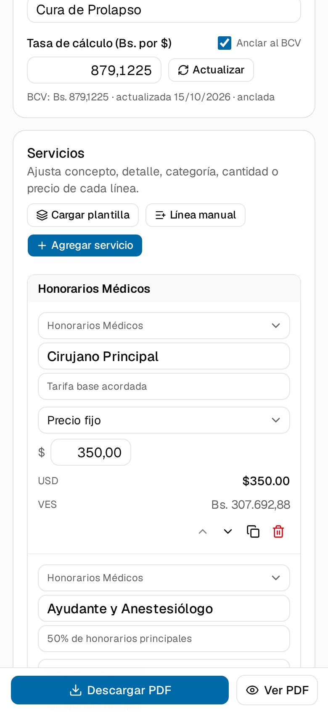
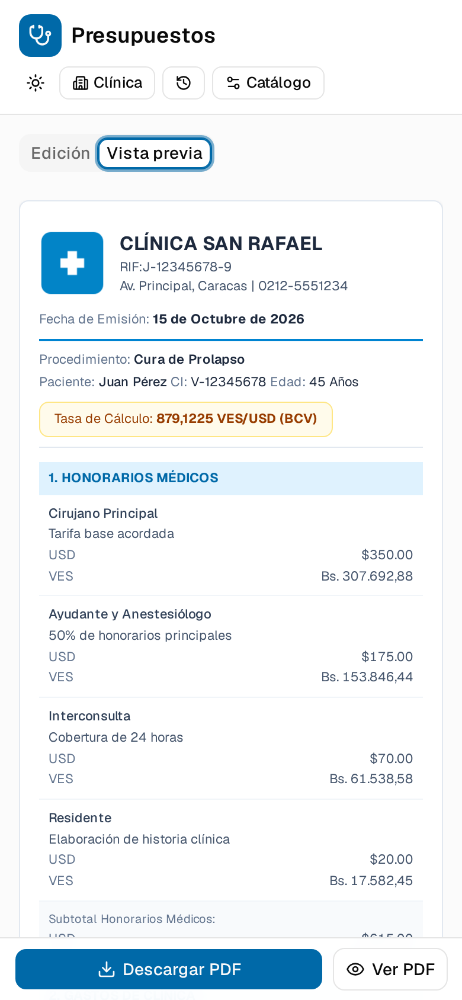

# 🩺 Presupuestos Médicos y Cotizaciones

**Una página web para hacer los presupuestos de tu clínica o consultorio y cotizaciones
de productos en minutos.**

Escribes los datos del paciente, agregas los servicios (cirugía, consulta, exámenes…), o
cambias a la modalidad de **cotización** para escoger productos del catálogo, y descargas un
**PDF listo para imprimir, guardar o enviar por WhatsApp**.

> ✅ No hay que instalar nada · ✅ no hay que crear cuenta · ✅ funciona sin internet ·
> ✅ **tus datos no salen de tu computadora**

### ▶️ Pruébala ahora: **[budgetify-silk.vercel.app](https://budgetify-silk.vercel.app)**

Se abre directo en el navegador, también en el teléfono. *(Es una demostración pública: no
escribas datos reales de pacientes en ella.)*

## ¿Qué hace?

- **Datos del paciente**: nombre, cédula y edad.
- **El procedimiento** y la fecha que tú elijas.
- **Los servicios**: honorarios médicos, gastos de la clínica, consultas, procedimientos,
  enfermería y estudios (ecografías, electrocardiograma, laboratorio, rayos X…).
- **Los precios los pones tú**: puedes cambiar cantidades, precios o agregar servicios
  propios. Se guardan para la próxima vez.
- **Calcula solo**: muestra el monto en **dólares** y en **bolívares**, con subtotales por
  categoría y el total general.
- **La tasa del dólar (BCV)** se actualiza sola; también la puedes escribir a mano.
- **Descarga el PDF**, lo imprimes o lo compartes por WhatsApp.
- **Historial**: guarda copias dentro del navegador (hasta 100) y vuelve a abrir
  cualquier presupuesto anterior cuando el paciente regrese.
- **Cotizaciones de productos**: cambia la modalidad, escoge varios productos del catálogo,
  ajusta cantidades, unidades, precios e **IVA por producto**, y obtén Sub-Total, IVA y Neto.
- **Respaldo en archivo**: Exportar / Importar JSON para llevarte todo a otro equipo.

## El documento que genera

Se ve como un presupuesto formal, con el **logo**, el **RIF** y los datos de tu clínica,
y al final un espacio para la **firma y el sello**:

## Cotizaciones de productos

En la parte superior puedes cambiar entre **Presupuesto médico** y **Cotización**. La
cotización tiene su propio catálogo de productos (código, descripción, unidad, precio e IVA)
y su propio formato de hoja:

- Se eligen **varios productos a la vez** desde un buscador con casillas.
- El **precio es la base sin IVA**; cada producto tiene su porcentaje (16 % por defecto, 0 %
  para exentos).
- El documento muestra **Código, Descripción, Cantidad, Unidad, Precio, % IVA, IVA y Neto**.
- Al final: **Sub-Total, IVA, Neto** y el total en bolívares con la tasa aplicada.
- El tamaño por defecto es **Carta**. Si el contenido pasa de una hoja, la cabecera, los
  datos del cliente y la cabecera de la tabla se repiten en las hojas siguientes.
- Los datos opcionales (código y RIF del cliente, teléfonos, dirección, vendedor, oficina,
  transporte, vencimiento, orden de compra y descripción) solo se imprimen si tienen valor.
- Los productos se gestionan en **Gestionar catálogo → Productos** y se incluyen en el
  respaldo JSON del catálogo.
- El **historial** guarda presupuestos y cotizaciones juntos, con un distintivo de tipo.

## Funciona en el teléfono

También en la tablet y en el teléfono, para que puedas hacer un presupuesto junto al
paciente:

  
  

## Para quién es

Médicos, odontólogos y personal administrativo de **consultorios, clínicas pequeñas y
unidades quirúrgicas** que hoy hacen los presupuestos a mano o en Word/Excel.

Elige tu **área de práctica** —Cirugía, Medicina General, Odontología, Traumatología y
Ortopedia, Pediatría, Ginecología y Obstetricia, o Dermatología— y el catálogo se enfoca en
lo tuyo sin perder los gastos generales (enfermería, estudios, gastos de clínica), que
cualquier especialista termina necesitando. Viene con **129 servicios y 12 plantillas**.

También sirve para un **profesional independiente sin clínica propia**: la hoja se encabeza
con tu nombre y tu título (“Od. Ana Rojas”) y debajo tu área de práctica.

## Cómo usarlo (paso a paso)

1. **Abre la página** en tu navegador (Chrome, Edge, Safari…).
2. Escribe el **nombre del paciente**, su cédula y su edad, y el **procedimiento**.
3. Pulsa **“Agregar servicio”** y elige los que necesites del catálogo, o **“Cargar
   plantilla”** para traer un conjunto ya armado (por ejemplo, una cirugía completa).
   Arriba del buscador tienes los **chips por área**: elige la tuya para ver solo lo tuyo,
   o “Todo el catálogo” para ver los 129 servicios.
4. Revisa y ajusta los precios en la tabla. Todo se recalcula al instante.
5. Pulsa **“Descargar PDF”**. También puedes **imprimirlo** o **mandarlo por WhatsApp**.
   Si quieres conservarlo a mano, **“Guardar copia en el historial”** (arriba, en
   **Historial**, lo vuelves a abrir después).
6. La primera vez, entra en **“Empresa”**: elige si los documentos son de una **clínica** o
   de un **profesional independiente**, escribe tu **título** (Dr., Dra., Od., Lcda.…) y tu
   **área de práctica**, y carga el RIF, el logo, la firma y el sello.

## Preguntas frecuentes

**¿Necesito internet?**
Solo la primera vez, para abrir la página. Después funciona sin conexión. Si hay internet,
aprovecha para actualizar sola la tasa del dólar del BCV.

**¿Mis datos se envían a algún servidor? ¿Son privados?**
Sí, son privados. **Nada se envía a ningún servidor**: todo se guarda únicamente en tu
navegador. No hay cuentas, no hay registro y no hay base de datos.

**¿Dónde quedan los presupuestos guardados?**
En el navegador del equipo donde trabajas. Además del que estás editando, puedes archivar
copias en **“Historial”** (se conservan las 100 últimas; al pasar de ahí se descartan las
más viejas y la app te avisa). Si cambias de computadora o quieres un respaldo, usa
**“Exportar JSON”** y luego **“Importar JSON”** en el otro equipo.

**Me equivoque, ¿puedo volver atrás?**
Sí. Al borrar una línea, una nota, una categoría o una copia del historial, o al reemplazar
el presupuesto, aparece un aviso con **“Deshacer”**. Lo que sí borra de verdad es
**“Limpiar”**: para eso pide confirmación.

**¿Puedo cambiar los precios?**
Sí. En **“Gestionar catálogo”** puedes editar precios, agregar o borrar servicios, crear
categorías nuevas y guardar plantillas para los casos que más repites. Cada servicio puede
pertenecer a un **área de práctica** o ser **transversal** (se ofrece en todas).

**¿Sirve para odontología? ¿Y para otras especialidades?**
Sí. Trae catálogos de arranque para **Cirugía, Medicina General, Odontología** (consulta,
restauradora, endodoncia, cirugía oral, periodoncia, ortodoncia, estética y odontopediatría),
**Traumatología y Ortopedia, Pediatría, Ginecología y Obstetricia** y **Dermatología**, con
precios de referencia de mercado que puedes editar.

**¿Se actualiza el precio del dólar?**
Sí, toma solo la **tasa oficial del BCV**. Si prefieres, puedes desmarcar *“Anclar al BCV”*
y escribir la tasa a mano.

**¿Puedo poner el logo, el RIF, la firma y el sello de mi clínica?**
Sí, en **“Empresa”**. Salen en el encabezado y al pie del documento. Si trabajas por tu
cuenta, activa **“Profesional independiente”** y la hoja se encabeza con tu nombre, tu
título y tu área.

**¿Puedo elegir el tamaño de la hoja?**
Sí: **A4**, Carta u Oficio.

**¿Sirve como historia médica?**
No. Es solo para **armar el presupuesto**. No guarda historias clínicas ni datos de
pacientes en ningún sistema.

**¿Cuánto cuesta?**
Nada. Es **gratis y de código abierto** (licencia MIT).

## ⚠️ Aviso importante

Los precios del catálogo son **orientativos**. Revisa siempre los montos y los datos del
documento antes de entregarlo al paciente. Esta herramienta ayuda a armar el presupuesto,
pero **no sustituye tu criterio médico ni administrativo**.

## 🔒 Privacidad y seguridad

- **No hay servidores**: nada de lo que escribes se envía a internet. No hay cuentas,
  registro ni base de datos.
- **Sin rastreadores**: no hay analítica ni cookies de terceros.
- La **única** conexión externa es la consulta de la tasa del BCV (que no lleva datos
  tuyos). Si la desmarcas y usas la tasa a mano, no hay ninguna conexión.
- Los datos quedan guardados **en este navegador**, incluido el **historial** de copias. En
  una computadora compartida, pulsa **Limpiar** al terminar, vacía el historial (cada copia
  se puede borrar) o usa una ventana de incógnito.
- Detalles y cómo reportar un problema: **[política de seguridad](SECURITY.md)**.

## ¿Quieres colaborar?

¡Eres bienvenido! Puedes reportar un error o proponer una mejora abriendo un *Issue*, o
enviar un *Pull Request*. Si eres desarrollador, mira la
**[documentación técnica](docs/DESARROLLO.md)** (stack, instalación, tests y despliegue).

## Licencia

[MIT](LICENSE) — puedes usarlo, modificarlo y compartirlo libremente citando al autor.

---

## English summary

**Medical Estimates** is a free, open-source web app that helps small clinics, sole
practitioners and dental offices in Venezuela create medical cost estimates (quotes): enter
the patient's data, pick services, and download a ready-to-print **PDF** in USD and VES
(BCV rate).

It ships with **practice-area catalogues** (Surgery, General Medicine, Dentistry, Trauma &
Orthopaedics, Paediatrics, OB-GYN and Dermatology) plus cross-cutting services such as
nursing and lab work, and the document can be headed either by a clinic or by the
professional ("Dr. Jane Doe" over her specialty). It keeps a **local history** of up to 100
estimates you can reopen, and every destructive action offers an undo.

**Live demo:** [budgetify-silk.vercel.app](https://budgetify-silk.vercel.app)

**100 % frontend** — no backend, no sign-up, no tracking. Everything is stored in the
browser, and it works offline. Built with React, TypeScript, Tailwind and
[`@react-pdf/renderer`](docs/DESARROLLO.md).

*Not a medical records system — it only builds the estimate.*
